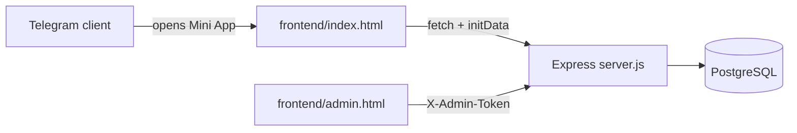

# Business club mini-app for Telegram

A Telegram Mini App for the participants of a business club's offline retreats. Participants vote
"karma" to the people whose contributions helped them, browse each other's profiles and see past and
upcoming retreats. Organisers manage retreats and participants and watch the voting in an admin panel.

## Features

- **Karma votes**: a participant rates how useful other people's contributions were (1–10 insights).
- **Profiles**: role, company, what the person can help with, strengths, tags. A participant claims a
  profile prepared by the organisers through their Telegram username, then edits it.
- **Retreats**: past, current and upcoming events with their participants.
- **Admin panel** (`/admin.html`): create and edit retreats, assign participants, see votes and stats;
  votes for oneself are flagged.

## How it works



- One Express server serves both the API and the static front end, so it deploys as a single service.
- The Mini App sends Telegram `initData` with its requests, and the server checks its HMAC-SHA256
  signature with the bot token. Profile edits require a valid signature; votes without `initData`
  are still accepted so the app can be tested in a regular browser.
- Votes are rate-limited to 5 submissions per hour per Telegram user; answers are validated on the server.
- Admin endpoints require the `ADMIN_TOKEN`; without it they stay disabled.
- Tables are created on first start, no migration tool needed.

## Stack

JavaScript, HTML/CSS (no framework), Node.js + Express, PostgreSQL (`pg`), Telegram Mini Apps, Railway.

## Run locally

```bash
npm install
cp .env.example .env      # fill in DATABASE_URL; BOT_TOKEN can stay empty for local testing
node --env-file=.env server.js
```

Open http://localhost:3000. Without `BOT_TOKEN` the signature check is skipped, so the app works in a
regular browser.

Import participants prepared by the organisers:

```bash
node --env-file=.env scripts/import-participants.js scripts/participants.example.json
```

## Deploy to Railway

1. New project → Deploy from GitHub repo.
2. Add a PostgreSQL database: Railway sets `DATABASE_URL`.
3. Set `BOT_TOKEN`, `ADMIN_TOKEN` and `NODE_ENV=production`.
4. Put your Railway address into the CORS list at the top of `server.js`.
5. In BotFather, set the Mini App URL to the Railway address.

---

This is a public copy of a private repository, without git history and participant data. The sample
participants in `scripts/participants.example.json` are fictional.
